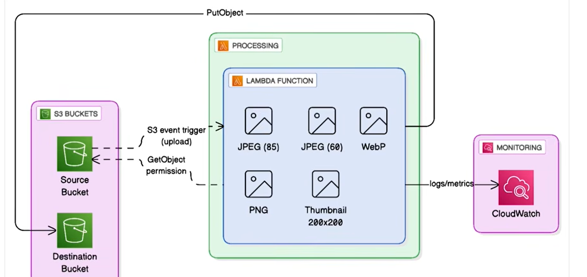

# Serverless Image Processor (S3 + Lambda + Pillow)

A serverless image processing pipeline. Uploading an image to S3 automatically triggers a Lambda function that generates multiple optimized variants and writes them to a separate output bucket. No server, no polling, no manual processing step.

## What This Solves

Most applications that accept images need several versions of each one: a thumbnail for lists, a compressed copy for fast page loads, a modern format like WebP for browsers that support it, and a lossless original for archiving. Producing these by hand, or with a long-running server, has real costs:

- **Manual work doesn't scale.** Resizing and re-encoding each upload in an editor or with a local script is slow, inconsistent, and depends on someone remembering to do it.
- **Always-on servers waste money.** A VM or container that waits for uploads costs the same at 3 a.m. with no traffic as it does at peak, and someone has to patch it, monitor it, and scale it.
- **Polling adds delay and cost.** A job that checks a bucket on a schedule either runs too often and wastes requests, or too rarely and leaves users waiting.
- **Native dependencies break in the cloud.** Image libraries like Pillow include compiled code, so a package built on a laptop often fails at runtime in Lambda.

This project processes each image the moment it lands in S3, pays only for the seconds the work takes, has no servers to manage, and ships a Pillow build that is guaranteed to run on Lambda.

## Architecture



Upload → S3 event → Lambda (Pillow layer) → 5 variants written to the processed bucket.

## Components

| Resource | Purpose |
|---|---|
| Upload S3 bucket | Source bucket for original images |
| Processed S3 bucket | Destination bucket for generated variants |
| Lambda function | Runs the image processing logic |
| Lambda layer | Pillow 10.4.0, built for Amazon Linux via Docker |
| S3 event notification + Lambda permission | Triggers the function automatically on upload |

## Deployment

```bash
./scripts/deploy.sh
```

This builds the Pillow layer (via Docker), runs `terraform init/plan/apply`, and prints the created bucket names and function name at the end.

## Usage

**Upload an image:**
```bash
aws s3 cp my-photo.jpg s3://<upload-bucket-name>/
```

**List generated variants:**
```bash
aws s3 ls s3://<processed-bucket-name>/ --recursive
```

**Download a specific variant:**
```bash
aws s3 cp s3://<processed-bucket-name>/my-photo_compressed_<id>.jpg ./
```

## Generated Variants

Each upload produces 5 outputs:

Before any variant is created, images larger than 4096 px on either side are downscaled to fit within 4096x4096 (aspect ratio preserved), and transparent images are flattened onto a white background.

1. **Compressed JPEG** (85% quality): balance of quality and size
2. **Low-quality JPEG** (60% quality): smallest file size
3. **WebP** (85% quality): modern format, better compression than JPEG at equivalent quality
4. **PNG**: lossless, largest file size
5. **Thumbnail** (fits within 300x300, aspect ratio preserved): small preview image

```
Original: photo.jpg (500 KB)
├── photo_compressed_a1b2c3d4.jpg (120 KB)
├── photo_low_a1b2c3d4.jpg (80 KB)
├── photo_webp_a1b2c3d4.webp (95 KB)
├── photo_png_a1b2c3d4.png (450 KB)
└── photo_thumbnail_a1b2c3d4.jpg (15 KB)
```

## Configuration

**Lambda environment variables:**
- `PROCESSED_BUCKET`: destination bucket, injected automatically by Terraform
- `LOG_LEVEL`: logging verbosity (default: `INFO`)

**Supported formats:** JPG, JPEG, PNG, WebP, GIF, BMP in; JPEG, PNG, WebP out.

## Monitoring

```bash
# Tail Lambda logs
aws logs tail /aws/lambda/<lambda-function-name> --follow

# Invocation count over the last hour
aws cloudwatch get-metric-statistics \
  --namespace AWS/Lambda \
  --metric-name Invocations \
  --dimensions Name=FunctionName,Value=<lambda-function-name> \
  --start-time $(date -u -d '1 hour ago' +%Y-%m-%dT%H:%M:%S) \
  --end-time $(date -u +%Y-%m-%dT%H:%M:%S) \
  --period 300 \
  --statistics Sum
```

## Customization

All variant settings live in `lambda/lambda_function.py`.

**Change compression levels or formats:** edit the `variants` list:
```python
variants = [
    {'format': 'JPEG', 'quality': 85, 'suffix': 'compressed'},
    {'format': 'JPEG', 'quality': 60, 'suffix': 'low'},
    {'format': 'WEBP', 'quality': 85, 'suffix': 'webp'},
    {'format': 'PNG', 'quality': None, 'suffix': 'png'}
]
```
`quality` applies to JPEG and WebP; set it to `None` for lossless formats such as PNG.

**Add a new variant:** append an entry to the same list. The loop saves it, sets the content type, and names the file automatically:
```python
{'format': 'JPEG', 'quality': 75, 'suffix': 'medium'}
```

**Change thumbnail size:** edit the `thumbnail()` call:
```python
thumbnail.thumbnail((300, 300), Image.Resampling.LANCZOS)
```
The image is scaled to fit inside this box with its aspect ratio preserved, so it is never stretched.

**Change the maximum input size:** edit `MAX_DIMENSION` at the top of the file:
```python
MAX_DIMENSION = 4096
```

## Design Notes

**Why a Lambda layer instead of bundling Pillow directly:** Pillow contains compiled C extensions. A binary built with `pip install` on Windows or macOS won't run inside Lambda's Amazon Linux environment. `scripts/build_layer_docker.sh` compiles Pillow inside a Linux container (`--platform linux/amd64`) so the resulting layer is actually Lambda-compatible, regardless of what OS it's built on.

**Why two buckets instead of one:** keeps source and processed content clearly separated, avoids the event-loop risk of a bucket's own writes re-triggering its own Lambda function, and lets each bucket have independent lifecycle/retention rules later if needed.

**Why `aws_s3_bucket_notification` needs an explicit `depends_on`:** the S3-to-Lambda permission (`aws_lambda_permission`) and the event notification wiring are separate resources with no direct reference between them. Without `depends_on`, Terraform could create the notification before the permission exists, briefly leaving S3 configured to invoke a function it isn't yet allowed to call.

**Why Lambda instead of EC2 or a container service:** image processing here is short, bursty, and triggered by events. Lambda runs only when an image arrives, scales automatically with the number of uploads, and costs nothing when idle. An EC2 instance or ECS service would need to run continuously, be patched, and have its scaling configured, all to handle work that takes a few seconds per image.

**Why S3 event notifications instead of polling or a queue:** S3 invokes the function directly when an object is created, so processing starts within seconds with no scheduler and no wasted requests. SQS between S3 and Lambda adds buffering and retry control, which only becomes worth its extra moving parts at much higher volume or when processing must survive long downstream outages.

**Why generate variants on upload instead of on request:** resizing when an image is requested (for example, behind CloudFront) means paying processing time on every cache miss and adding latency for the first viewer. Generating all variants once at upload means every later read is a plain S3 GET. The trade-off is storing five extra objects per image, which costs fractions of a cent at this scale.

**Why a unique suffix on output file names:** each invocation generates an 8-character ID (`uuid4`) and appends it to every variant. Two uploads with the same name would otherwise overwrite each other's variants in the processed bucket; the suffix keeps every run's output distinct, so re-uploading `photo.jpg` never silently replaces earlier results.

**Why a variant list instead of separate code per format:** every output is one entry in a list of `format`, `quality`, and `suffix`, processed by a single loop that handles saving, file naming, and content type. Adding or changing a variant is a one-line edit, with no new code path to test.

**Why cap input at 4096 px:** a decoded image takes roughly width × height × 3 bytes in memory, and five variants are produced from it. Without a cap, a single very large upload could exhaust the function's memory or run past the timeout. 4096 px keeps every invocation within predictable memory and duration while staying well above any web display size.

**Why transparent images are flattened onto white:** JPEG has no alpha channel, so transparent pixels must be filled with a colour before saving. Converting everything to RGB once, up front, gives every variant the same consistent appearance and avoids the black or garbled backgrounds that appear when RGBA images are saved directly as JPEG.

**Why 1024 MB of Lambda memory:** images are decoded fully into memory, and five variants are created from each one, so 1024 MB leaves headroom for larger uploads without hitting out-of-memory errors.

**Why deploy and destroy are wrapped in scripts:** deployment has a step Terraform can't do on its own, building the Pillow layer in Docker before `terraform apply`. Teardown has one too: S3 buckets that still contain objects (including old versions) can't be deleted, so `destroy.sh` empties them first. The scripts make both operations a single command that can't skip a step.

**Why Terraform for everything:** the buckets, function, layer, permission, and notification are defined together in code, so the whole pipeline can be created, reviewed, and torn down repeatably. Nothing depends on console clicks that would be forgotten or done differently next time.

## Cost Estimate

Approximate monthly cost, based on AWS's published pricing:

- S3 storage: $0.023/GB (first 50 TB)
- Lambda: first 1M requests free, then $0.20/1M
- Lambda duration: first 400,000 GB-seconds free
- S3 requests: $0.0004 per 1,000 PUT requests

**1,000 images/month ≈ $0.50–$2.00**, driven mostly by Lambda duration and S3 storage of the 5 generated variants per image.

## Security

- All S3 buckets are private, with no public access
- IAM least privilege: the Lambda execution role only has access to the specific buckets it needs
- S3 access restricted to this specific Lambda function via a scoped `source_arn` condition on the invoke permission

## Known Limitations

- No frontend. Pure backend automation, driven entirely by the AWS CLI/SDK
- No VPC isolation configured by default
- Max image size is bounded by Lambda's allocated memory (1024 MB)
- Lambda timeout is set to 60 seconds in Terraform. Large images or additional variants may need this raised
- Transparency is not preserved. RGBA and LA images are flattened onto a white background, so PNG and WebP outputs of transparent images (e.g. logos) have a white fill
- Images larger than 4096 px on either side are downscaled before processing, so the originals' full resolution is not kept in any variant

## Cleanup

```bash
./scripts/destroy.sh
```

Empties both S3 buckets (including all object versions) and destroys all Terraform-managed resources.
